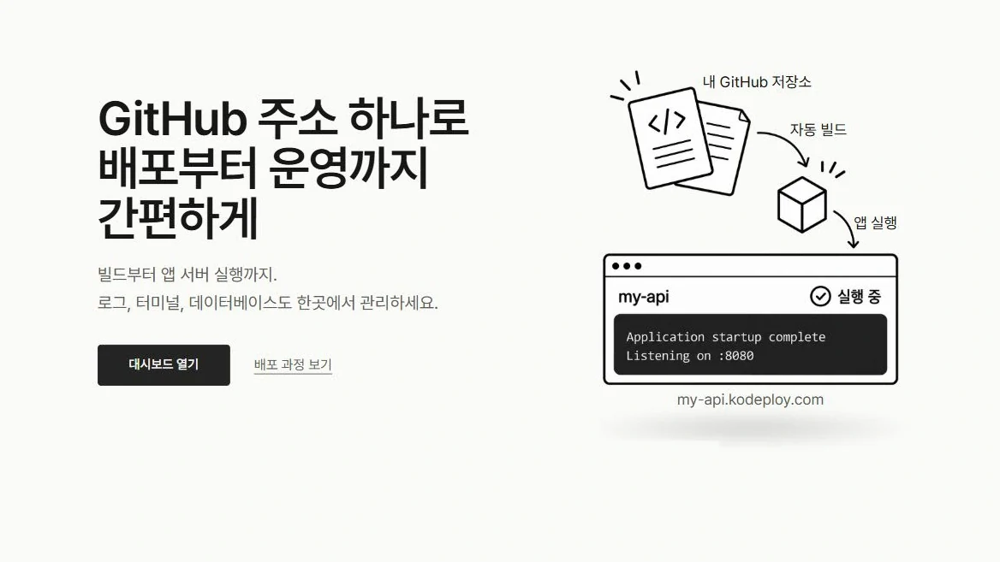
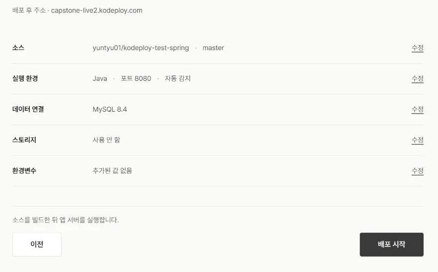
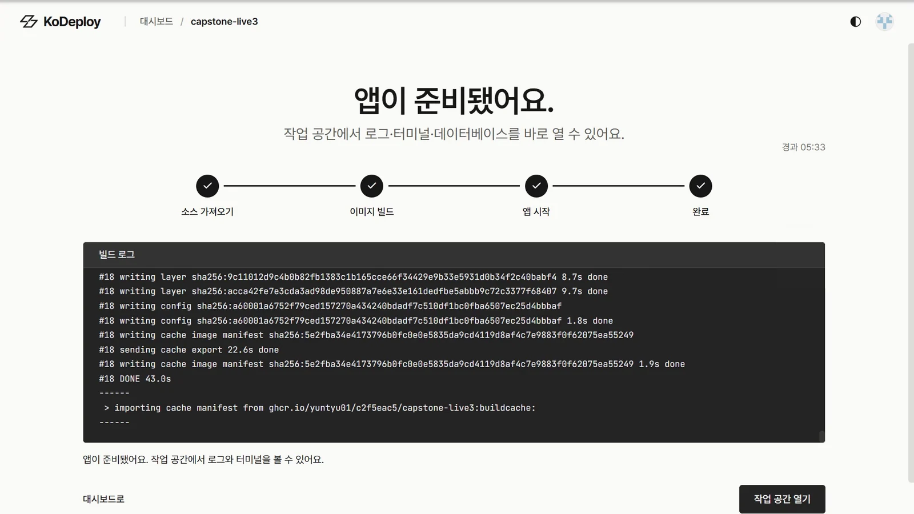
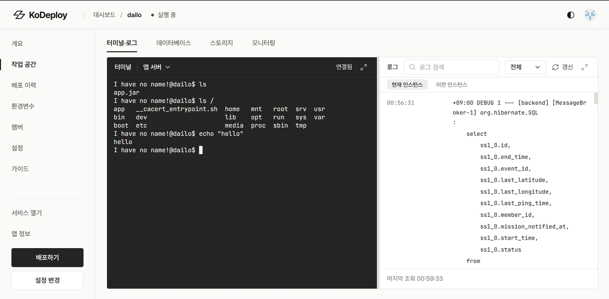
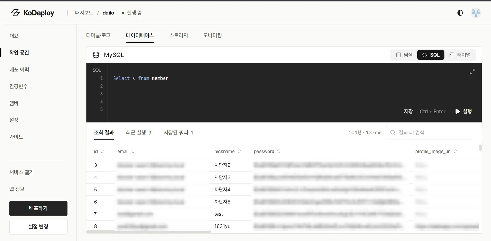
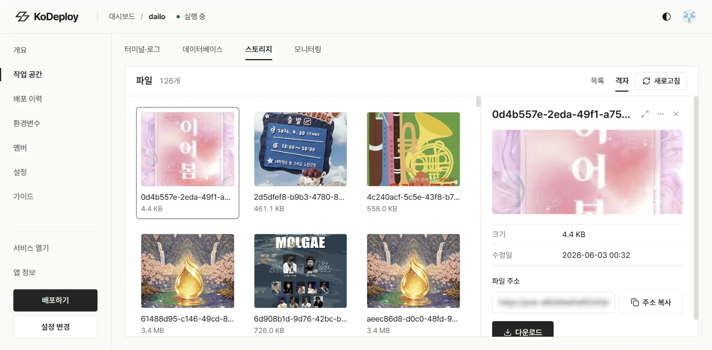
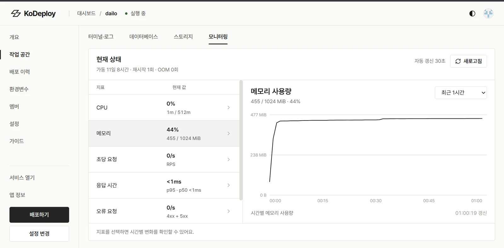

# KoDeploy

GitHub 저장소 URL을 받아 컨테이너로 빌드하고 `{앱이름}.kodeploy.com` 서브도메인으로 서비스하는 미니 PaaS. self-service 배포, 런타임별 golden path, K8s 추상화, 멀티테넌시를 갖춘 작은 IDP(Internal Developer Platform)다.

Heroku 무료 티어가 사라진 뒤 학생이 캡스톤이나 해커톤 결과물을 올릴 곳이 마땅치 않다. Railway나 Render는 슬립이 잦거나 금방 과금으로 넘어간다. 학교나 동아리 규모의 신뢰 기반 사용자라면 클러스터 하나를 공유해서 이 문제를 풀 수 있겠다 싶어 만들었다. 지금은 지인 초대 기반으로 [app.kodeploy.com](https://app.kodeploy.com)에서 운영 중이다.

OCI Always Free ARM 한도(4 OCPU / 24GB) 안에서 노드 3대로 운영하고, 월 운영비는 0원이다. 노드 위에는 kubeadm으로 직접 구성한 Kubernetes 클러스터(Calico, Envoy Gateway)가 돌아간다. 사용자는 kubectl을 쓰지 않는다. 배포는 웹, GitHub Actions, CLI 세 곳에서 요청하고, 빌드는 Go로 만든 빌더가, 클러스터 적용은 Argo CD가 맡는다. 앱마다 네임스페이스를 따로 두고 PSS restricted와 Calico 정책으로 격리한다. 단독 운영하는 프로젝트다. 백엔드(core)도 이 클러스터 위에서 돌아가고, 프론트는 Cloudflare에서 정적으로 서빙한다.

설계 결정과 구축 과정은 [기술 블로그](https://yuntyu01.github.io/Archive/blog/)에, 전체 구조는 [아키텍처 문서](https://yuntyu01.github.io/Archive/architecture/)에 정리해 두었다.



## 배포하는 세 가지 방법

### 웹

첫 배포는 저장소 → 실행 환경 → 확인 3단계다. 저장소 주소를 넣으면 브랜치 목록을 불러오고, `pom.xml` 같은 파일로 런타임을 추정한다. 런타임(Python, Java, PHP, JavaScript, Go, 정적), 포트, DB, 스토리지, 환경변수를 고르고 배포를 누르면 빌드 로그가 1초 단위로 올라온다.

그 뒤로는 두 버튼으로 나뉜다. **배포하기**는 최근 커밋 3개 중 하나를 골라 지금 설정 그대로 다시 빌드하고, **설정 변경**은 마지막 설정이 채워진 폼을 다시 연다. 앱마다 지금 떠 있는 커밋이 기록된다.

<p>
  
  
</p>

### GitHub Actions

앱 설정에서 **GitHub Actions 배포 허용**을 켜면 push할 때 워크플로가 재배포를 요청한다. 저장소에 넣어 둘 비밀이 없다. 워크플로가 GitHub의 OIDC ID 토큰(audience `kodeploy`)을 받아 core에서 짧게 쓰는 CI 토큰으로 바꾸고, 빌드는 워크플로가 돈 커밋으로 한다.

```yaml
on:
  push:
    branches: [main]
permissions:
  id-token: write
  contents: read
jobs:
  deploy:
    runs-on: ubuntu-latest
    steps:
      - uses: kodeploy/deploy-action@v1
        with:
          app: <앱 id>   # 앱 설정 > GitHub Actions에 나온다
```

- core는 토큰을 바꿔 줄 때 저장소 ID와 브랜치를 확인하고, 앱에 워크플로 파일을 지정해 두었으면 그 파일에서 실행된 잡인지도 확인한다.
- 앱의 다른 슬롯이 다른 저장소나 다른 브랜치에서 왔다면, 그 슬롯은 브랜치 최신이 아니라 지금 떠 있는 커밋으로 고정한다. 한 저장소의 push가 다른 저장소의 아직 배포하지 않은 커밋을 끌고 나가지 않게 하려는 것이다.
- 같은 실행을 다시 보내도 빌드는 한 번만 시작한다 (`Idempotency-Key`).
- 액션은 [kodeploy/deploy-action](https://github.com/kodeploy/deploy-action)이다. 체크섬이 고정된 CLI를 받아 재배포를 요청하고, 앱이 뜰 때까지 기다려 결과를 잡 결과로 돌려준다.

### CLI

로컬 터미널에서 재배포하고, 앱 셸과 DB 콘솔에 붙는다. 앱 주인이 앱 설정에서 CLI 토큰을 발급해서 쓴다. 토큰 원문은 발급할 때 한 번만 보이고, 앱마다 살아 있는 토큰은 하나다(다시 발급하면 이전 토큰은 바로 끝난다). 마지막으로 쓴 뒤 15분, 발급 뒤 최대 8시간이 지나면 만료된다.

[릴리스](https://github.com/kodeploy/kodeploy/releases)에 Linux · macOS(amd64, arm64) 바이너리가 있다.

```sh
curl -fsSL https://github.com/kodeploy/kodeploy/releases/download/cli-v0.3.0/kodeploy_0.3.0_linux_amd64.tar.gz | tar xz kodeploy

export KODEPLOY_APP=<앱 id>
read -rs KODEPLOY_TOKEN && export KODEPLOY_TOKEN   # 토큰을 붙여 넣고 엔터

kodeploy commits               # 최근 커밋 3개와 지금 떠 있는 커밋
kodeploy deploy                # 브랜치 최신으로 배포하고 끝날 때까지 기다림
kodeploy deploy --pick         # 최근 커밋 3개 중에서 골라 배포
kodeploy deploy --sha <sha>    # 그 커밋(40자)으로 배포
kodeploy shell                 # 앱 컨테이너 셸
kodeploy db                    # DB 콘솔
kodeploy redis                 # Redis 콘솔
```

`deploy`는 결과를 exit code로 돌려준다. 0 성공, 1 실패, 2 사용법 오류, 3 다른 배포에 밀림, 4 시간 초과, 125 인증 실패, 130 중단. 시간 초과나 Ctrl+C로 멈춰도 서버 빌드는 계속 진행된다.

## 배포 흐름

1. 웹, GitHub Actions, CLI 중 한 곳에서 배포를 요청한다. 요청마다 빌드할 커밋이 정해진다(브랜치 최신, 고른 커밋, 워크플로가 돈 커밋).
2. core가 빌더에 빌드를 요청하고, 빌더는 `kodeploy-build` 네임스페이스에 rootless BuildKit Job을 만든다. Job은 그 커밋을 그대로 clone하고, 저장소에 Dockerfile이 있으면 그대로 쓰고 없으면 nixpacks가 Dockerfile을 만든다. 빌드 캐시는 GHCR에 둔다.
3. 빌더가 이미지를 GHCR에 올린 뒤 이미지 digest를 GitOps 저장소(`kodeploy-apps`)의 앱별 `values.yaml`에 커밋하고, 실제로 빌드한 커밋을 core에 알려 준다.
4. Argo CD가 공통 차트(`kodeploy-charts`)와 그 값으로 앱 네임스페이스에 적용한다(server-side apply, prune, selfHeal). 빌더는 동기화와 앱 Pod 상태를 지켜보다가 앱이 뜨지 않으면 로그 끝부분을 붙여 실패로 알린다.
5. `*.kodeploy.com` 와일드카드 DNS가 이미 로드밸런서를 가리키고 있어 별도 DNS 작업 없이 바로 접속된다. HTTPS는 Cloudflare 프록시와 Envoy Gateway의 TLS 종료로 적용된다.

빌더는 클러스터를 직접 바꾸지 않고 Git에 기록만 한다. 실제 상태는 Argo CD가 그 기록대로 맞추므로, 롤백은 이전 이미지로 값을 되돌리는 일이다.

private repo는 GitHub App 설치로 지원한다. 빌드 시점에 1시간짜리 installation token을 발급해 clone하고, 토큰은 해당 유저의 repo에만 스코프된다.

비밀번호 같은 Secret 값은 Git에 넣지 않고 core가 클러스터에 직접 쓴다.

## 앱 구성

한 사용자가 여러 앱을 만들 수 있고, 앱 개수 상한은 등급으로 정한다. 앱마다 네임스페이스가 따로 생긴다. 앱은 다른 사용자와 공유할 수 있고, 권한은 보기(viewer)와 편집(editor) 두 가지다.

앱은 두 슬롯으로 구성된다. 서버 슬롯은 Python, Java, PHP, JavaScript, Go 런타임으로 돌고 `{앱이름}-api.kodeploy.com`으로 접속한다. 정적 슬롯은 빌드 산출물을 nginx로 서빙한다. 정적 슬롯을 켜면 `{앱이름}.kodeploy.com`이 정적 사이트로 넘어가고 서버 주소는 그대로 유지된다.

서버 슬롯에는 MySQL, PostgreSQL, Redis, 영속 스토리지를 토글로 붙일 수 있다. DB를 켜면 접속 정보가 환경변수(`DB_HOST`, `DB_PORT`, `DB_NAME`, `DB_USER`, `DB_PASSWORD` 등)로 자동 주입된다. 토글을 꺼도 PVC와 데이터는 보존되고, 다시 켜면 그대로 복원된다. 오브젝트 스토리지는 Cloudflare R2에 앱마다 버킷을 만들고 그 버킷에만 쓸 수 있는 토큰을 발급하는 방식이다.

### 작업 공간

배포한 뒤의 운영은 앱의 작업 공간에서 한다. 서버에 들어갈 일이 없다.

| 웹 터미널 · 실시간 로그 | 데이터베이스 |
|---|---|
|  |  |
| **스토리지** | **모니터링** |
|  |  |

- 웹 터미널과 DB · Redis 콘솔. CLI의 `kodeploy shell`, `db`, `redis`도 같은 세션이다.
- 앱 로그 검색, 지금 인스턴스와 이전 인스턴스 로그
- DB 탐색 · SQL 실행 · 저장한 쿼리, DB 덤프와 복원
- R2 스토리지 브라우저 (미리보기, 내려받기, 주소 복사)
- 메트릭(VictoriaMetrics): CPU, 메모리, 초당 요청 수, 응답 시간, 오류 요청, 재시작 · OOM 횟수

그 밖의 기능은 다음과 같다.

- 커스텀 도메인 연결 (Cloudflare for SaaS custom hostname)
- 이전 빌드로 롤백
- 환경변수 관리
- 빌드 · 배포 실패 원인을 LLM으로 분석하는 AI 진단. 로그와 함께 비-root, 포트 일치, 빌드 네트워크 차단 같은 플랫폼 제약을 알려 주고, 원인과 근거 로그 한 줄, 복사해서 쓸 수정 방법을 받는다. 로그는 사용자 코드가 찍는 입력이라 모델에 도구를 주지 않고, 결과는 그 사용자 화면에 보여 주기만 한다.

## 격리와 권한

남의 코드를 한 클러스터에서 돌리므로, 앱이 다른 앱이나 플랫폼에 닿지 못하게 막는다. 자세한 그림은 아키텍처 문서의 [네트워크 격리](https://yuntyu01.github.io/Archive/architecture/04-network-isolation.html)와 [권한 구조](https://yuntyu01.github.io/Archive/architecture/05-permissions.html)에 있다.

- 앱 Pod은 PSS restricted 네임스페이스에서 UID 1000으로만 돈다. 권한 상승과 capability는 막혀 있고, ServiceAccount 토큰은 마운트하지 않는다.
- CPU, 메모리, 임시 디스크에 런타임별 상한이 있다.
- Calico 정책으로 앱에 들어오는 길은 같은 네임스페이스와 Envoy뿐이고, 나가는 길은 DNS와 공인 인터넷뿐이다. 다른 앱, 플랫폼, 노드 사설망, 메타데이터 엔드포인트는 막힌다. 빌드 Job도 같은 규칙을 따른다.
- core의 클러스터 전역 권한은 6개이고, 네임스페이스 생성과 RoleBinding은 ValidatingAdmissionPolicy가 정해진 모양만 허용한다.
- core에는 Pod exec 권한이 없다. 터미널과 DB 콘솔은 앱 네임스페이스마다 둔 exec 게이트웨이가 맡는다. 브라우저와 CLI는 core에서 받은 1회용 티켓으로 게이트웨이에 붙고, core가 게이트웨이를 부르는 내부 연결은 HMAC 서명과 앱마다 따로 만든 인증서로 고정한 TLS를 쓴다.

## 구조

```
terraform/   OCI 인프라(VCN, 노드, NLB)와 Cloudflare(DNS, 터널, 보안)
ansible/     클러스터 부트스트랩. containerd부터 Envoy Gateway까지 순서대로
deploy/k8s/  플랫폼 매니페스트 (core, 빌더, Argo CD, Gateway, 모니터링, Calico)
core/        백엔드. FastAPI. 앱, 사용자, 배포 요청 관리
builder/     빌더. Go. BuildKit Job으로 빌드하고 GitOps 저장소에 값을 커밋
exec/        exec 게이트웨이. Go. 웹 터미널과 DB 콘솔의 Pod 접속
cli/         kodeploy CLI. Go. 재배포, 커밋 고르기, 셸 · DB 접속
web/         프론트. React + Vite. Cloudflare에 정적 배포
docs/        기술 문서와 README 이미지
```

GitHub Actions 액션은 별도 저장소([kodeploy/deploy-action](https://github.com/kodeploy/deploy-action))에 있다. 앱 차트와 앱별 값도 별도 저장소(`kodeploy-charts`, `kodeploy-apps`)에 있고, 둘 다 비공개다.

## 로컬 실행

호스티드 서비스라 로컬 실행은 개발용이다. 백엔드와 DB만 docker-compose로 뜬다.

```sh
docker compose up        # MySQL + API (localhost:8000)
cd web && npm run dev    # 프론트 (localhost:5173)
```

GitHub 로그인이 필요하면 `GITHUB_CLIENT_ID`/`GITHUB_CLIENT_SECRET` 환경변수를 넣어야 한다. 빌드와 배포는 K8s 클러스터, 빌더, Argo CD, GHCR 자격증명이 있어야 동작한다.

## 다음에 할 것

- gVisor로 사용자 앱 격리 강화. 지금은 사용자 컨테이너가 노드 커널을 그대로 공유한다.
- Vault로 앱 Secret 이전. 지금은 core가 K8s Secret을 직접 쓰기 때문에 앱 네임스페이스의 Secret 권한이 core에 남아 있다.
- HPA로 앱 오토스케일링. 지금은 앱마다 Pod 수가 고정이다.
- 운영 중인 앱에서 버튼 하나로 테스트용 stage, dev 환경을 띄우는 기능
- 사용자 알림 (사이트, 이메일)
- 설치형으로 공개. 차트와 설정 저장소까지 정리해서 다른 학교나 동아리가 자기 클러스터에 그대로 설치할 수 있게 한다.
